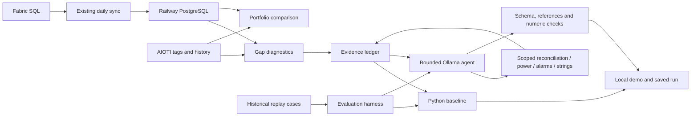

> Study copy: runtime examples and evaluation cases in this repository are synthetic. Production measurements and physical device assignments are excluded.

# Energy Performance Copilot architecture

The project combines deterministic energy analysis with one tool-using local LLM. Python retains ownership of arithmetic, classifications, scope and persistence. The model proposes evidence-linked interpretations and selects additional read-only tools.

## Data-gap diagnosis

`copilot/diagnostics.py` resolves exactly one SAP ID, reads its confirmed inverter mapping and Railway generation, and optionally queries Fabric directly. It checks the AIOTI catalog, short-window history for corrected daily energy, cumulative energy and active power, plus the daily max aggregation route.

- Missing tag: catalog successfully loaded but corrected-energy tag absent.
- Derived-energy gap: corrected energy absent while another checked telemetry channel is available.
- Suspected telemetry gap: the three checked histories are unavailable. This does not prove hardware failure or a total platform outage.
- Suspected aggregation gap: raw corrected energy exists but its daily aggregate does not.
- Fabric source gap: the source was actually checked and has no record.
- Sync gap: Fabric has a valid record but Railway does not.
- API errors, invalid readings and unverified aggregates are separate states.

A series is filtered to `[local midnight, next local midnight)`. Null, nonfinite, negative and duplicate readings cannot silently become usable energy. Zero is retained as a legitimate observation. No fallback energy estimate is inserted. The shared daily parser is also used by the existing portfolio report.

## Bounded agent

Scope is fixed by the Python caller: one SAP and one completed day. The model has no shell, SQL, mapping-write or messaging tool. It can call at most four additional tools over four tool-selection steps plus one structured-output step by default. Model requests have a 90-second timeout. Existing source functions have their own request/page limits; these are not a hard global wall-time guarantee.

Tool selection runs without a JSON output grammar, followed by a separate structured-output request. Combining the output grammar with tool selection can prevent tool calls. Every tool produces an evidence ID, output and trace with elapsed time. The output contract separates observations, hypotheses, missing evidence, recommended checks and typed numeric metrics. Unknown evidence references, invalid schemas and mismatched numeric metric paths trigger the Python fallback.

These checks do **not** establish semantic entailment. A real evidence ID can still be cited incorrectly in prose. The phrase filter is a limited guard, not a hallucination detector. Human review and adversarial evaluations remain necessary. Agent unavailability is returned as `baseline_fallback`, never disguised as model success.

String inspection discovers actual string-current tags and reports availability. If the API has no such tags, the tool returns `capability_unavailable`. It does not invent string channels or classify faults from unmatched channel layouts.

## Evaluation

This study copy includes five fictional demonstration cases, explicitly marked synthetic. No private historical measurements are included. Unit-test edge cases are also synthetic.

The harness compares Python and Ollama, recording reference/metric validation, prohibited-certainty checks, tool failures, completion, elapsed time and tokens. Replay tools return only recorded fictional responses, and unrecorded evidence stays unavailable.

Semantic support accuracy, expert-confirmed root causes and dollar compute cost remain unmeasured. Expected-classification checks verify replay consistency, not independent production diagnostic accuracy.

## Interface and runtime

`copilot/app.py` serves the local interface and historical replay by default. Live mode requires `COPILOT_ENABLE_LIVE=1`. The app binds to loopback in the documented command, has no remote authentication, and is not a public service. Replay needs no cloud credentials; agent mode additionally needs Ollama. Live mode reuses the existing `.env`, PostgreSQL, Azure CLI/Fabric and AIOTI setup.

Run reports are stored under `.copilot_runs/`. The existing LaunchAgent still runs generation sync only; the new investigations are not added to that schedule. Scheduling heavier weekly analysis should follow validation of the daily report.
